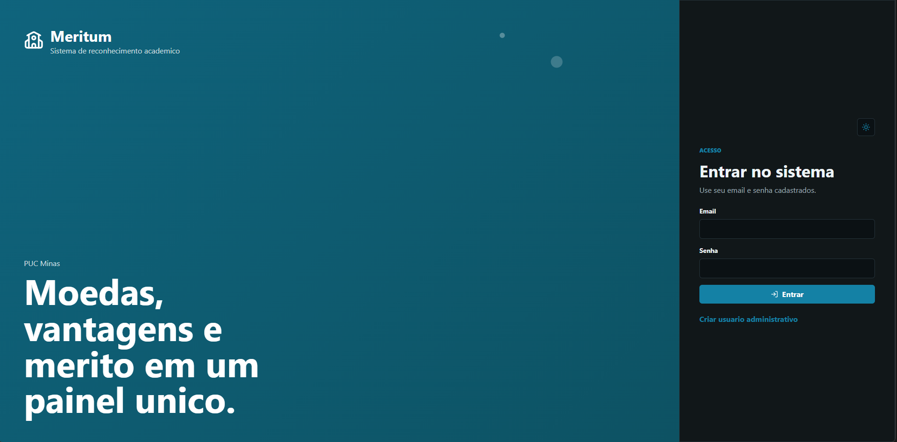
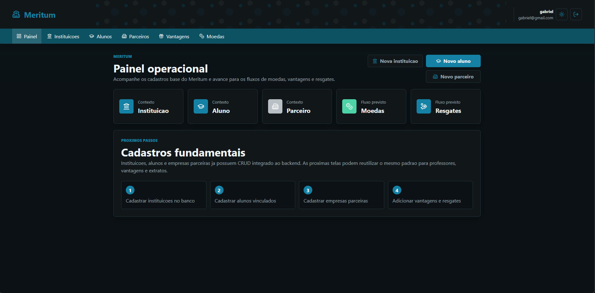

# Meritum

Sistema acadêmico de moeda estudantil para reconhecimento de mérito. Professores distribuem moedas a alunos da mesma instituição; alunos consultam saldo e extrato e resgatam vantagens cadastradas por empresas parceiras.

## Estado atual

O repositório contém um protótipo web em React e uma API Fastify com PostgreSQL. Catálogo de vantagens, resgate com débito de saldo, código de cupom e envio de notificações estão implementados no código. A entrega de e-mail depende do provedor configurado e não é confirmada pela resposta HTTP do resgate.

Não há fluxo de validação/consumo de cupom pelo parceiro nas rotas atuais. As suítes existentes cobrem autenticação, instituições, alunos e moedas; não demonstram aceite completo de vantagens, resgates ou mensageria.

## Funcionalidades e perfis

| Contexto      | Comportamento presente                                                                                   |
| ------------- | -------------------------------------------------------------------------------------------------------- |
| Autenticação  | Login JWT, renovação com token válido e troca de senha                                                   |
| Administração | Gestão de instituições, alunos, professores e empresas parceiras; acompanhamento de vantagens e resgates |
| Professor     | Envio de moedas a alunos da mesma instituição e extrato de movimentações                                 |
| Aluno         | Consulta de saldo/extrato, catálogo ativo, resgate de vantagem e consulta dos cupons                     |
| Parceiro      | Gestão das próprias vantagens e consulta de resgates                                                     |
| Comunicação   | Eventos de domínio para e-mails, com RabbitMQ opcional e fallback em memória                             |
| Notícias      | Endpoint de notícias de educação com conteúdo demonstrativo em caso de falha externa                     |

Os perfis internos são `ADMIN`, `PROFESSOR`, `STUDENT` e `PARTNER`; as respostas e guards usam os identificadores correspondentes em minúsculas.

## Arquitetura e tecnologias

```text
React/Vite → API Fastify → serviços de aplicação → repositórios Prisma → PostgreSQL
                                  ↓
                        eventos de domínio → memória ou RabbitMQ → e-mail
```

- Backend: TypeScript, Fastify 5, Prisma 6, JWT, Swagger/OpenAPI e Vitest.
- Frontend: React 19, TypeScript, Vite 7 e React Router.
- Banco: PostgreSQL 17 no Compose, com migrações Prisma versionadas.
- Integrações: `amqplib`, Resend, Nodemailer e geração de QR Code.

Os módulos em `Codigo/Backend/src/modules/` separam entrada HTTP (`action`), aplicação, domínio, infraestrutura e respostas conforme cada contexto. Responsabilidades comuns ficam em `src/shared/`. O schema completo, incluindo `Advantage`, `Redemption` e `Transaction`, está em [prisma/schema.prisma](Codigo/Backend/prisma/schema.prisma).

## Execução com Docker

Pré-requisitos: Git, Docker e Docker Compose em execução. Portas padrão: 5432, 5672, 15672, 3333 e 5173.

```bash
git clone https://github.com/PHnsilva/Meritum.git
cd Meritum
```

Copie [Codigo/Backend/.env.example](Codigo/Backend/.env.example) para `Codigo/Backend/.env`. No PowerShell:

```powershell
Copy-Item Codigo/Backend/.env.example Codigo/Backend/.env
```

Para a demonstração local, configure `ADMIN_EMAIL=admin@meritum.com` e **`ADMIN_PASSWORD=admin123`**. O exemplo define a senha como string vazia: ela precisa ser preenchida para o seed criar o administrador. Gere um `JWT_SECRET` próprio. As credenciais de demonstração servem apenas ao ambiente local.

```bash
docker compose up --build
```

O Compose inicia PostgreSQL, RabbitMQ, backend e frontend. O comando do backend aplica migrações, executa o seed e inicia a API. O seed atual cria somente o administrador; instituições e outros perfis devem ser cadastrados pelo sistema. Se o e-mail já existir, o seed não troca sua senha.

| Serviço          | Endereço local               |
| ---------------- | ---------------------------- |
| Interface        | http://localhost:5173        |
| API / health     | http://localhost:3333/health |
| Swagger          | http://localhost:3333/docs   |
| RabbitMQ Manager | http://localhost:15672       |

Os usuários/senhas do PostgreSQL e RabbitMQ no [Compose](docker-compose.yml) são exemplos locais. Não reutilize essa configuração de desenvolvimento em produção.

## Execução manual

Use Node.js 22.12 ou superior na série 22, compatível com as imagens `node:22` e os requisitos do Vite, e PostgreSQL acessível. RabbitMQ é opcional: deixe `RABBITMQ_URL` vazia para usar o barramento em memória.

Depois de copiar e preencher o `.env`, a partir da raiz:

```bash
cd Codigo/Backend
npm ci
npm run prisma:generate
npx prisma migrate deploy
npm run prisma:seed
npm run dev
```

`prisma migrate deploy` aplica as migrações existentes. `npm run prisma:migrate` usa `migrate dev` para desenvolver novas migrações.

Em outro terminal, na raiz do clone:

```bash
cd Codigo/Frontend
npm ci
npm run dev
```

Se necessário, configure `VITE_API_URL=http://localhost:3333` em `Codigo/Frontend/.env`; essa URL é pública e entra no bundle. Não coloque segredos em variáveis `VITE_`.

## Configuração

O backend carrega `.env` por `dotenv`. O exemplo completo está em [Codigo/Backend/.env.example](Codigo/Backend/.env.example).

| Variável                                           | Uso                                                                      |
| -------------------------------------------------- | ------------------------------------------------------------------------ |
| `DATABASE_URL`                                     | PostgreSQL usado por Prisma e pelos testes                               |
| `PORT`, `HOST`                                     | Padrões `3333` e `0.0.0.0`                                               |
| `JWT_SECRET`                                       | Assinatura JWT; obrigatório em produção                                  |
| `NODE_ENV`                                         | Ambiente; controla exigências de configuração e seed                     |
| `CORS_ORIGINS`                                     | Origens permitidas, separadas por vírgula; sem valor, usa origens locais |
| `FRONTEND_URL`                                     | Base dos links enviados por e-mail                                       |
| `ADMIN_EMAIL`, `ADMIN_PASSWORD`                    | Conta criada pelo seed quando ainda não existe                           |
| `RABBITMQ_URL`                                     | Habilita transporte AMQP; sem valor, usa memória                         |
| `RABBITMQ_EXCHANGE`                                | Padrão `meritum.domain-events`                                           |
| `RABBITMQ_QUEUE_PREFIX`                            | Padrão `meritum`                                                         |
| `RESEND_API_KEY`                                   | Seleciona o provedor Resend                                              |
| `SMTP_HOST`, `SMTP_USER`, `SMTP_PASS`, `SMTP_PORT` | SMTP quando Resend não está configurado                                  |
| `MAIL_FROM`                                        | Remetente; `SMTP_FROM` permanece como fallback                           |

Sem Resend ou SMTP configurados, o serviço tenta usar uma conta Ethereal e imprime um link de preview. Isso não entrega e-mail real. Produção exige um provedor habilitado e remetente válido.

## API e interface

O contrato interativo fica em `/docs`. Rotas de negócio protegidas recebem `Authorization: Bearer <token>` e aplicam perfil/pertencimento conforme cada operação.

| Rotas principais                                                                         | Uso                                            |
| ---------------------------------------------------------------------------------------- | ---------------------------------------------- |
| `POST /api/auth/login`, `/api/auth/refresh`, `/api/auth/alterar-senha`                   | Login, renovação e senha                       |
| `/api/instituicoes`, `/api/alunos`, `/api/professores`, `/api/parceiros`                 | Cadastros e consultas por perfil               |
| `POST /api/moedas/enviar`                                                                | Distribuição de moedas                         |
| `GET /api/moedas/extrato/professor/:professorId`, `/api/moedas/extrato/aluno/:studentId` | Movimentações                                  |
| `GET /api/vantagens`                                                                     | Catálogo ativo para usuários autenticados      |
| `GET /api/vantagens/admin`, `/api/vantagens/minhas`                                      | Visão administrativa ou do parceiro            |
| `POST /api/vantagens`, `PUT/DELETE /api/vantagens/:id`                                   | Cadastro e manutenção de vantagens             |
| `POST /api/vantagens/:id/resgatar`                                                       | Resgate pelo aluno                             |
| `GET /api/resgates`, `/api/vantagens/resgates`, `/api/vantagens/:id/resgates`            | Consultas de cupons conforme perfil            |
| `GET /api/noticias/educacao`                                                             | Notícias ou conteúdo demonstrativo de fallback |

No frontend, `/vantagens` oferece catálogo ou gestão conforme o perfil; `/vantagens/nova` e `/vantagens/:id/editar` atendem à manutenção. Os componentes e guards completos estão em [AppRoutes.tsx](Codigo/Frontend/src/app/routes/AppRoutes.tsx).

O token e o usuário ficam em `localStorage` na chave `meritum:user`. A renovação usa o JWT existente e não implementa um refresh token independente. O resgate desconta saldo e grava o cupom na mesma transação; o e-mail ocorre por evento depois disso.

## Mensageria e limites

Com RabbitMQ configurado, o transporte declara exchange topic e filas duráveis, publica mensagens persistentes com confirmação do broker e confirma consumo após o handler. Mensagens rejeitadas seguem para filas `.dead-letter`. Sem URL, o barramento é local e não durável.

A publicação no barramento é assíncrona em relação à resposta da operação. Falhas AMQP registram erro e tentam o handler local. Não há outbox transacional nem deduplicação persistida de consumidores: sucesso do cadastro/resgate não garante entrega de e-mail, e uma falha incerta pode produzir repetição. O código de transporte está em [rabbitmq-event-transport.ts](Codigo/Backend/src/shared/infra/messaging/rabbitmq-event-transport.ts).

O endpoint de notícias possui configuração fixa no código e fallback demonstrativo. Antes de publicar essa integração, externalize a credencial e revise sua rotação, sem copiá-la para documentos ou logs. A revisão documental não altera essa implementação.

## Validação

Dentro de `Codigo/Backend/`:

```bash
npm run prisma:generate
npm run build
npm run lint
npm test
```

As suítes em [src/tests/](Codigo/Backend/src/tests/) usam `app.inject()` com PostgreSQL real. Configure um **banco de testes dedicado**, aplique as migrações e crie o administrador esperado pelos helpers (`admin@meritum.com` / `admin123`, somente nesse banco). Deixe `RABBITMQ_URL` vazia para a execução sem broker. Os testes criam registros e não devem usar um banco de produção. Não há suíte específica de vantagens ou de entrega AMQP/e-mail nesta base.

Dentro de `Codigo/Frontend/`, execute `npm run build`. Não há script de testes do frontend no manifesto atual. Resultados de compilação ou teste precisam ser registrados para cada execução; a existência dos comandos não comprova aprovação.

## Estrutura e documentação

```text
Codigo/
  Backend/   API, módulos, Prisma, migrações e testes
  Frontend/  interface React, rotas e componentes
Artefatos/   modelagem e capturas
docker-compose.yml
```

- [Documentação do backend](Codigo/Backend/README.md).
- [Modelagem](Artefatos/modelagem/).
- [Telas](Artefatos/telas/). As capturas versionadas são referências, sem garantia de retratar cada mudança posterior.

| Login                                  | Dashboard                                      |
| -------------------------------------- | ---------------------------------------------- |
|  |  |

## Contribuição

Projeto em equipe. Use uma issue concreta, branch própria e pull request para revisão independente. Preserve os créditos e informe o ambiente e os checks executados. Mudanças de contrato, migrações ou eventos precisam considerar frontend, banco e consumidores.

## Autores

Projeto desenvolvido em grupo.

| Nome             | GitHub                               | LinkedIn                                                |
| ---------------- | ------------------------------------ | ------------------------------------------------------- |
| Pedro H. S.      | <https://github.com/PHnsilva>        | <https://www.linkedin.com/in/phnsilva1/>                |
| Felipe Parreiras | <https://github.com/FelipeParreiras> | <https://www.linkedin.com/in/felipe-parreiras04/>       |
| Gabriel Nonato   | <https://github.com/GpNonato>        | <https://www.linkedin.com/in/gabriel-nonato-3a3a98376/> |

---

## Licença

Este projeto está sob a licença **MIT**.

Consulte o arquivo [`LICENSE`](LICENSE) para mais detalhes.
